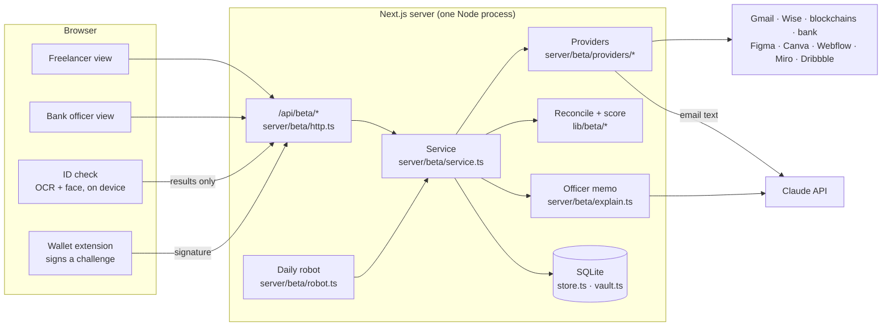
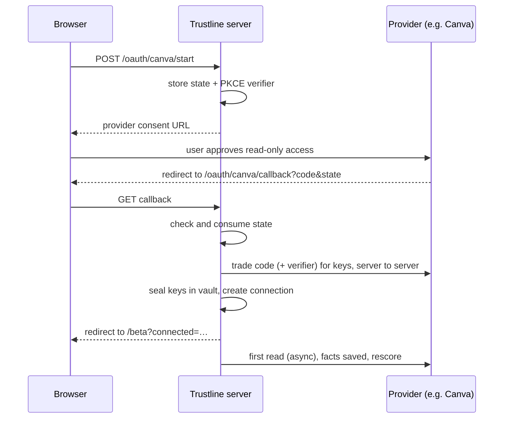
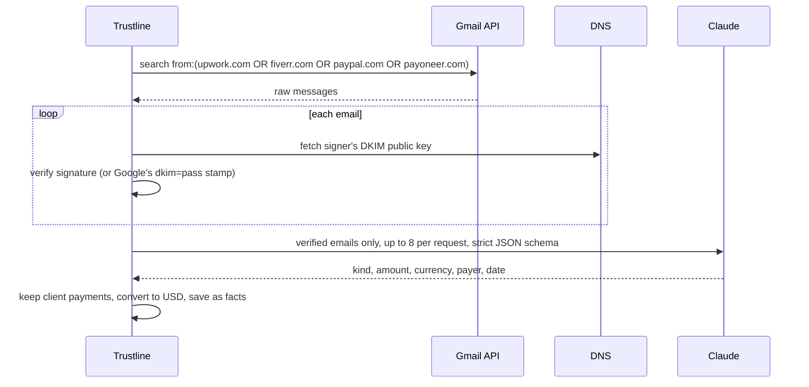
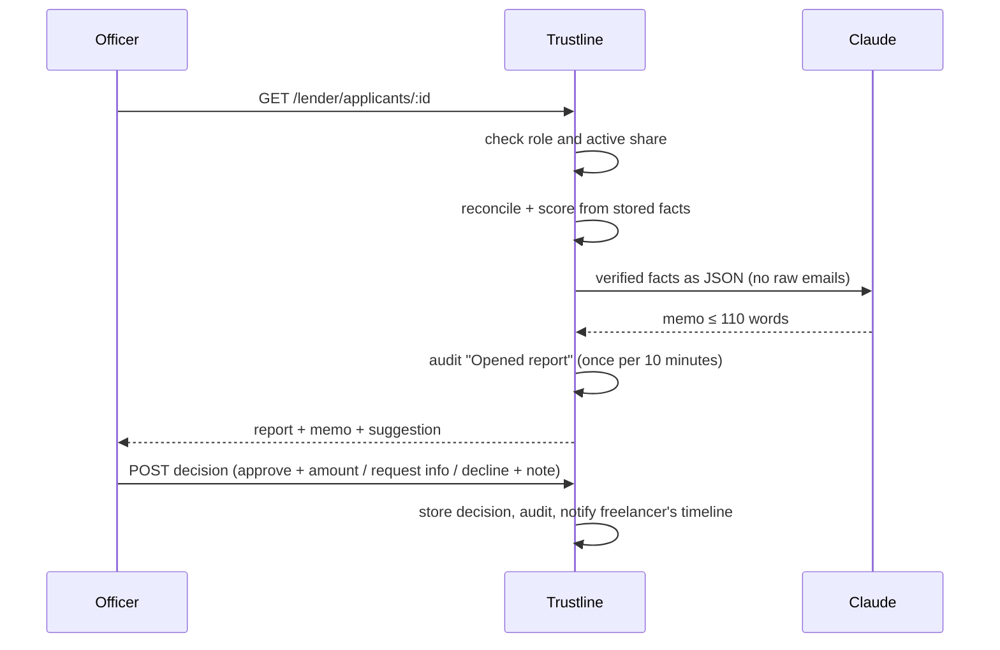

# Architecture

Trustline is one Next.js application. A single Node process serves the pages, the JSON API and a background job, and stores everything in one SQLite file. There is no separate backend service, queue or cache: for a single-server product this keeps deployment to one command and makes every part testable in-process.

Related documents: [Scoring engine](SCORING.md) · [API reference](API.md) · [Security and privacy](SECURITY.md) · [Connecting real accounts](CONNECTORS.md)

## System overview

## Layers

| Layer | Where | Responsibility |
|---|---|---|
| Pages | `app/beta/page.tsx`, `app/beta/mock-consent/` | One page for both roles: the freelancer dashboard or the bank officer's workspace, chosen by the logged-in user's role. The mock consent page exists only in demo mode. |
| UI components | `components/beta/` | Source cards, Figma and wallet dialogs, ID check, live timeline ("Behind the scenes"), score panel, payments and work tables, sharing card, lender list and review. |
| Browser client | `lib/beta/client.ts` | Typed `fetch` wrapper for `/api/beta`. The session is an HttpOnly cookie, so the browser never handles a token. |
| HTTP API | `app/api/beta/[...path]/route.ts` → `server/beta/http.ts` | One route handler for every endpoint. Parses JSON, checks the session, origin and role, maps errors to status codes. Takes a Web `Request`, returns a `Response`, so tests call it directly. |
| Service | `server/beta/service.ts` | All business logic: sign-up and login, connecting sources, syncing, scoring, sharing, the lender report, decisions, the robot pass. |
| Providers | `server/beta/providers/` | One file per outside source. Each turns an API's answer into plain facts (`payments` or `work`) and writes its steps to the timeline. |
| Shared logic | `lib/beta/` | Pure functions used by both server and browser: scoring, reconciliation, the officer suggestion, MRZ parsing, name matching, currency conversion, wallet signing helpers, types. |
| Storage | `server/beta/store.ts`, `schema.ts`, `db.ts`, `vault.ts` | SQLite access, schema migrations, AES-256-GCM vault for access keys. |
| Background | `server/beta/robot.ts`, started by `instrumentation.ts` | Re-reads stale connections on a timer. |
| Demo stand-ins | `server/beta/demo.ts` | Replaces the network layer in demo mode (see below). |

## The pipeline

1. **Connect.** The freelancer links a source in one of four ways:
   - **OAuth 2.0 sign-in** (Google, Canva, Webflow, Miro, Dribbble, Figma): a random `state` (and a PKCE verifier where the provider supports it) is stored, the user approves on the provider's own site, and the server trades the one-time code for read-only keys.
   - **Pasted read-only token** (Figma, Wise, Webflow).
   - **Wallet signature**: the server issues a one-time message; the wallet signs it; the server verifies the signature (EVM secp256k1, Solana Ed25519, Tron) to prove ownership of the address.
   - **File upload**: the monthly bank statement (CSV or open-banking JSON).

   Access keys are sealed with AES-256-GCM (`vault.ts`) before they are written.
2. **Read and verify at the source** (`server/beta/providers/`):

   | Source | What is read | How it's verified |
   |---|---|---|
   | Gmail | Only emails from Upwork, Fiverr, PayPal and Payoneer, last 13 months (the search runs on Google's side) | DKIM signature checked against the company's public key in DNS, or Google's delivery-time verdict. Others are discarded. Claude, or built-in rules, then extracts amount, currency, payer, date and kind (client payment, payout, invoice, fee, refund). |
   | Wise | Incoming transactions from every currency balance statement, last 13 months | Read directly from Wise with the user's read-only token |
   | Wallets | Incoming USDT/USDC on Ethereum, Base, Polygon, Arbitrum, Optimism; USDT on Tron; USDC/USDT on Solana | Ownership by signature; only official token contracts count; transfers under $1 (spam, "address poisoning") are ignored |
   | Bank statement | Credits from the uploaded file | Labelled "from bank statement" and shown separately from payments verified at source |
   | Bank identity | The account holder's name only (no balances, no transactions) | Open banking (Berlin Group NextGenPSD2), the person approves on the bank's page |
   | Figma | Version history the user created, comments by others, file names | Read from Figma's API with the user's token |
   | Canva | Owned designs: creation and edit dates, titles | Canva Connect API |
   | Webflow | Sites, publish dates, custom domains, page edits | Webflow Data API |
   | Miro | Board items edited or created by the user, board members | Miro REST API |
   | Dribbble | Published shots | Dribbble API |

   Designs themselves are never copied: only dates, titles and who else took part.
3. **Reconcile** (`lib/beta/reconcile.ts`): all payments are re-decided together on every rescore. The same payment seen at two sources within 7 days and 4% counts once (the most direct source wins: email and Wise, then wallet, then bank). A bank deposit that is a payout from a connected platform counts where the client paid. Transfers between the user's own wallets, exchange top-ups and dust never count.
4. **Score** (`lib/beta/score.ts`, full details in [SCORING.md](SCORING.md)): a deterministic points scorecard, 300–850, bands A–E, with plain-language reasons and risk flags. Every rescore is stored in `beta_scores`, so the score history is kept.
5. **Share.** The freelancer picks a lender account and shares the report. The share can be revoked at any time; a lender without an active share gets 403.
6. **Review.** The officer opens the applicant: score, reasons, flags, payments, work, identity and the system's suggestion (`lib/beta/decision.ts`). Claude writes a memo of at most 110 words from the verified facts only (`explain.ts`); if Claude is unavailable, refuses or errors, a rule-based memo is shown and the fallback is logged.
7. **Decide.** The officer approves (with a monthly amount), requests information or declines (both need a note). The decision records whether it followed or overrode the suggestion. Every view and decision goes to the audit trail, which the freelancer can see.

## How the main flows run

### Connecting a source with OAuth

### Verifying a payment email

### Lender review

## Runs, the timeline and the daily robot

Every read is a **run**. Each step of a run (who did what, with the technical detail such as the exact API call) is written to `beta_timeline`, and the page polls it every 1.5 seconds right after an action and every 10 seconds otherwise. That is "Behind the scenes" in the UI.

The **daily robot** (`robot.ts`) starts once with the server. Every `ROBOT_CHECK_MINUTES` (default 10) it re-reads any connection not synced for `ROBOT_MAX_AGE_HOURS` (default 24), refreshing expired OAuth keys first, and rescores. Reports stay current without anyone clicking. One failing source (rate limit, outage) is logged and retried later without blocking the others.

## Demo mode

`DEMO_MODE=1` swaps the network layer, not the logic. `server/beta/demo.ts` supplies a `fetch` and a DNS resolver that answer for every outside service with synthetic data for one designer, Nino Beridze:

- payment emails are really DKIM-signed with a demo key published through the stand-in DNS, and one forged PayPal email is included, so the signature check runs for real and rejects it;
- every "Connect" button goes to a labelled mock consent page instead of the provider;
- public blockchains are the exception: a visitor's own wallet is read for real;
- the bank officer account (ana@citybank.demo) is created on start.

Everything after the network (verification, extraction, reconciliation, scoring, the Claude memo, the decision, the audit trail) is the same code as in real mode.

## Data model

SQLite tables (`server/beta/schema.ts`), all prefixed `beta_`. Migrations are additive and run on start.

| Table | Key columns | Holds |
|---|---|---|
| `users` | id, email, name, password_hash, role, org | Freelancer and lender accounts (scrypt hashes) |
| `sessions` | token_hash, user_id, expires_at | Sessions; only the SHA-256 of the token is stored; 14 days |
| `connections` | id, user_id, provider, status, secret, settings, last_sync_at, last_error | Connected sources; `secret` is vault ciphertext |
| `oauth_states` | state, user_id, provider, verifier | One-time sign-in state and PKCE verifier |
| `wallet_challenges` | id, family, address, message, expires_at | One-time messages for wallet ownership |
| `payments` | connection_id, ext_id, at, amount_usd, asset, chain, payer, status, proof, source | Payment facts; `proof` links to the evidence (explorer link, email check) |
| `work` | connection_id, ext_id, at, kind, item, person, source | Work facts: version, edit, publish, comment, shot |
| `scores` | user_id, at, score, report | Every score with its full report |
| `identity` | user_id, status, report | ID check result (no photos) |
| `shares` | user_id, lender_id, created_at, revoked_at | Who may see a report |
| `decisions` | user_id, lender_id, officer, decision, amount_usd, note, recommendation, score | Officers' decisions with the suggestion at the time |
| `audit` | user_id, lender_id, actor, action, detail | Shares, revocations, report views, memos, decisions |
| `timeline` | user_id, run_id, actor, level, text, tech | Step-by-step log shown in the UI |

## Errors and resilience

- Provider errors carry a user-facing message and status (`ProviderError`): an expired key asks the user to reconnect, a missing permission says which, a 429 says the robot will retry.
- A connection's last error is stored and shown on its card; other connections keep working.
- OAuth keys are refreshed automatically five minutes before they expire.
- Claude failures never block a report: extraction falls back to rules, the memo falls back to a labelled rule-based text.

## Testing

`npm test` runs Vitest suites against the real service and HTTP handler with an in-memory SQLite database and stubbed `fetch`:

- `beta.test.ts`: scoring rules, payment classification, wallet signatures (EVM, Solana, Tron), the vault (tamper detection), own-wallet transfers, disconnect wiping facts, cross-site and non-JSON writes blocked;
- `beta-sources.test.ts`: DKIM checks (genuine, edited amount, forged sender, Google's stamp), email extraction, de-duplication and payouts, client matching across scripts, MRZ parsing for ID cards and passports, statement import, and every source connected end to end through the API;
- `beta-bank-id.test.ts`: open-banking identity (owner name only, a different holder, a declined permission, a bank that isn't set up);
- `beta-lender.test.ts`: consent, the lender report with reasons, human decisions and the audit trail.

Type checking (`tsc --noEmit`, strict) and ESLint run alongside.

## Deployment

`render.yaml` defines two web services from the same code: `trustline` (real mode) and `trustline-demo` (`DEMO_MODE=1`). Build: `npm ci && npm run build`; start: `npm start`. The app reads `PUBLIC_URL`, or Render's `RENDER_EXTERNAL_URL`, to build OAuth redirect addresses behind the host's proxy. Data lives in the SQLite file at `TRUSTLINE_DB_PATH`; on a free instance it resets on restart, so lasting data needs a persistent disk.

## Adding a new source

1. Write `server/beta/providers/<name>.ts`: read the API, return `payments` or `work` facts, log steps to the run.
2. For OAuth, add an entry to `OAUTH` in `providers/oauth.ts` (endpoints, scopes, PKCE, client auth).
3. Register the reader in `service.ts` (`syncOne`) and add a card in `components/beta/`.
4. Add a stand-in to `demo.ts` and a test to `beta-sources.test.ts`.

Scoring needs no change: new facts flow into the same factors.

## Stack

Next.js 15 (App Router, Turbopack), React 19, TypeScript (strict), Tailwind CSS 4, Radix UI, better-sqlite3, Anthropic SDK, mailauth (DKIM), viem (EVM signatures), tesseract.js and Human (in-browser OCR and face checks), Vitest.
