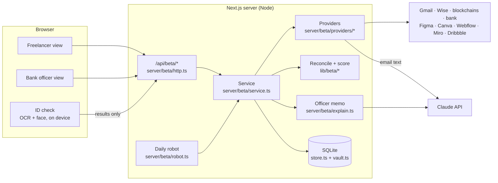

# Architecture

Trustline is one Next.js application. The same Node process serves the pages, the JSON API and a background job, and keeps its data in a SQLite file.

## The pipeline

1. **Connect.** The freelancer signs in to a source (OAuth 2.0 with state and, where supported, PKCE), pastes a read-only token (Figma, Wise, Webflow), signs a one-time message with a crypto wallet, or uploads a monthly bank statement. Access keys are sealed with AES-256-GCM in `server/beta/vault.ts` before they are stored.
2. **Read and verify at the source** (`server/beta/providers/`):
   - **Gmail**: only emails from payment companies are requested. Each must pass a DKIM signature check against the company's public key in DNS, or carry Google's delivery-time verdict. Claude then extracts the amount, currency, client and date (`email-extract.ts`), with built-in rules as a fallback.
   - **Wise**: incoming money from each balance statement.
   - **Wallets**: ownership proven by a signature; only transfers of genuine USDT/USDC contracts count.
   - **Bank**: identity through open banking (owner name only, no balances or transactions); transactions from the uploaded statement, labelled as such.
   - **Work tools**: Figma version history, Canva designs, Webflow sites and pages, Miro board edits and collaborators, Dribbble shots. Only dates, titles and collaborators are kept, never the designs.
3. **Reconcile** (`lib/beta/reconcile.ts`): the same payment seen twice counts once, payouts (Upwork → bank) count where the client paid, and transfers between the freelancer's own wallets never count.
4. **Score** (`lib/beta/score.ts`): a deterministic points model, the same facts and date always giving the same result. It starts at 500 and adds or removes points per factor, clamped to 300–850, bands A–E:

   | Factor | What it measures |
   |---|---|
   | Verified monthly income | Typical month over the last 6, from proven payments only |
   | Months with income | Regularity over the last 12 months |
   | Income stability | Month-to-month variation |
   | Client spread | Number of payers and dependence on the largest |
   | Track record | Months of verifiable history |
   | Design work evidence | Weeks with real work in the connected tools |
   | Work matches income | Paid months that also show work |
   | Clients seen in work and payments | The same client in both, e.g. a Figma collaborator who also pays |
   | Identity | Confirmed by the bank and/or the ID check |

   Risk flags: a name on an income account that doesn't match the ID, a sudden income jump just before applying, and income without design work. A high-severity flag caps the score at 599. The suggested maximum monthly payment is 30% of verified income.
5. **Share.** The freelancer picks a bank and shares the report; the share can be revoked.
6. **Review** (`lenderReport` in `service.ts`): the officer sees the score, reasons, flags, payments, work and the system's suggestion (`lib/beta/decision.ts`: approve, manual review or decline; any flag means manual review). Claude writes a short memo from the verified facts only (`explain.ts`); if it is unavailable, a labelled rule-based memo is used.
7. **Decide.** The officer approves (with an amount), requests information or declines (with a note). Views and decisions go to an audit trail that the freelancer can see.

The **daily robot** (`server/beta/robot.ts`, started from `instrumentation.ts`) re-reads every connection older than 24 hours and rescores, so a report stays current without clicks. Every step of every read is written to a timeline that the UI shows live as "Behind the scenes".

## Demo mode

`DEMO_MODE=1` swaps the network layer, not the logic. `server/beta/demo.ts` provides a `fetch` and a DNS resolver that answer for every outside service with synthetic data for one designer. The demo emails are really DKIM-signed with a demo key published through the stand-in DNS, and one is forged, so the signature check runs for real. Sign-in buttons go to a labelled mock consent page. The bank officer account (ana@citybank.demo) is created on start.

## Data model

SQLite tables (`server/beta/schema.ts`), all prefixed `beta_`:

| Table | Holds |
|---|---|
| `users`, `sessions` | Accounts (scrypt password hashes) and sessions (only token hashes stored) |
| `connections`, `oauth_states`, `wallet_challenges` | Connected sources with sealed secrets; one-time sign-in and signature challenges |
| `payments`, `work` | Facts read from sources |
| `scores`, `identity` | Score history; ID check and bank identity results |
| `shares`, `decisions`, `audit` | Who may see a report, officers' decisions, every access |
| `timeline` | The step-by-step log shown in the UI |

## API and security

All endpoints live under `/api/beta/*` in one handler (`server/beta/http.ts`) that takes a Web `Request` and returns a `Response`, so tests call it directly without a server. Sessions are HttpOnly cookies. State-changing calls must be JSON from the app's own origin, which blocks cross-site form posts. Sign-up and login are rate-limited. Lender endpoints check the role and an active share for every applicant.

## Stack

Next.js 15 (App Router, Turbopack), React 19, TypeScript (strict), Tailwind CSS, Radix UI, better-sqlite3, Anthropic SDK, mailauth (DKIM), viem (EVM signatures), tesseract.js and Human (in-browser OCR and face checks), Vitest.
